# Knowledge base module

**Status:** design, October 2026. Decisions: [ADR 0011](adr/0011-knowledge-base-and-retrieval.md) for retrieval, [ADR 0024](adr/0024-knowledge-sources-storage-and-sync.md) for sources, storage, sync, agent tools and the lexical index.

**Scope:** the MVP knowledge base: workspace-level collections of sources, uploads and Google Docs, the ingestion pipeline, retrieval, the agent search tool, the playground and the safety rules around deletion.

**Not in this document:** custom tools and channels, except where the knowledge module integrates with runs or notifications.

---

## 1. What the module does

A workspace creates knowledge bases, adds sources and attaches a knowledge base to an Agent step. The platform prepares each document once, then answers search queries from the prepared index at chat time.

The module owns:

- knowledge base CRUD and the search-tool identity the LLM sees;
- uploads and Google Docs connections;
- the fetch → parse → chunk → embed → index pipeline;
- the retrieval index and `search_knowledge`;
- schedules and manual re-sync;
- index status, errors and the retrieval playground;
- the “in use by an agent” guard on deletion.

The module does **not** let the agent read a whole knowledge base or browse its documents. The only agent-facing operation is a search with a natural-language question (ADR 0024).

### 1.1 In plain words

A knowledge base is a prepared library, not a folder the agent reads.

You give us a file or pick Google Docs. We keep the originals, then a background helper reads each document, breaks it into section-sized pieces, writes a one-time summary you can edit, gives every piece a meaning fingerprint and records its important words. The pieces go into a searchable catalog.

When a customer asks a question, the agent asks the catalog for the few most relevant pieces and answers from them. It never receives the whole library.

Preparing takes time, so it happens in the background. The user sees “Queued”, then “Preparing”, then “Ready”. If a document is updated, the old version keeps answering until the new one is completely ready.

### 1.2 MVP boundaries

| Area | MVP | Later |
|---|---|---|
| Sources | File uploads; Google Docs picked through Google Picker | Google Drive folders, Notion, ClickUp, pages written on the platform, custom sources via API |
| Google access | `drive.file`, selected documents only | `drive.readonly` with restricted-scope verification and CASA, or Workspace domain-wide delegation |
| Sync | Initial import, manual “Sync now”, optional scheduled hourly / daily / weekly | Real-time change notifications |
| Parsing | PDF text layer, DOCX, TXT, MD, Google Docs Markdown export | OCR and vision parsers for scanned PDFs |
| Retrieval | Vector + true BM25 + trigram, RRF, section expansion | Reranking, query rewrite, automatic retrieval mode |
| Agent tools | One `search_knowledge` per attached KB | Browse/read tools, whole-KB prompt mode |
| Embeddings | Platform model, stored per KB | BYOK embeddings and model migration |
| Playground | Query, ranked results with source and section | “Save as test”, judgements, evaluation datasets |

### 1.3 Success criteria

- A user can create a knowledge base, upload a PDF or pick Google Docs, and see a clear status until the content is searchable.
- A customer question with paraphrased wording finds the right passage, while exact names, prices and codes still match.
- Re-sync never exposes a half-indexed document: the old generation stays searchable until the new one flips.
- Deleting a knowledge base is impossible while any current agent draft or live version uses it.
- The agent cannot read the whole knowledge base and cannot browse it; each search is focused and bounded.

---

## 2. Decisions at a glance

| # | Decision | Record |
|---|---|---|
| K1 | Sources are uploads and Google Docs. ClickUp and real-time sync are out of the MVP. | ADR 0024 |
| K2 | Google Docs uses `drive.file` and Google Picker. The app gets only the documents the user picks; a picked folder does not expose its children. | ADR 0024 |
| K3 | One source per “Add source” action: an upload is one file, a Google Picker action is one source that may contain several documents. | ADR 0024 |
| K4 | Uploads go browser → S3/Silo through a presigned URL. The API never receives the file bytes. | ADR 0024 |
| K5 | The original upload and the canonical Markdown are both kept in object storage, so re-indexing never asks the user to upload again. | ADR 0024 |
| K6 | Re-index writes a new per-document generation and flips `documents.active_generation` in one transaction. Old results stay live until the flip. | ADR 0024 (refines ADR 0011) |
| K7 | The agent gets one `search_knowledge` tool per attached KB, with the KB's editable tool name and description. No browse/read tools and no whole-KB prompt. | ADR 0024 (amends ADR 0011) |
| K8 | Retrieval is vector + true BM25 + trigram, fused with RRF and expanded to sections. BM25 uses a term-frequency table, not `tsvector` scoring. | ADR 0024 (refines ADR 0011) |
| K9 | A source is imported once on creation. “Sync now” is always available. Google Docs can also have an hourly, daily or weekly schedule; uploads have no schedule. Manual re-sync is a run trigger, not a stored mode. | ADR 0024 |
| K10 | Deleting a KB is blocked while any current agent draft or live version references it. | ADR 0024 |
| K11 | The module stores everything in Postgres with RLS; no second search store. Exact vector search is scoped to the KB. | ADR 0011, ADR 0024 |
| K12 | The parser, Google client, S3 client and embedding gateway sit behind abstractions with fakes. | ADR 0011 |

---

## 3. Domain model

```
knowledge_bases 1 ── n sources 1 ── n documents 1 ── n sections 1 ── n chunks
                         │                    │                         │
                         │                    │                         └── n chunk_terms
                         │                    └── n sync_runs
                         └── n connections (Google accounts)

embedding_cache (workspace-scoped, shared by documents)
```

| Concept | Meaning |
|---|---|
| **Knowledge base** | A named collection plus the search-tool name and description the LLM sees. Belongs to one workspace. |
| **Connection** | A Google account connected to the workspace. Stores the encrypted refresh token. |
| **Source** | One thing the user added: an uploaded file, or one Google Picker selection. Holds the optional sync schedule and status. |
| **Document** | One imported document. An upload source has one document; a Google source has one per picked Google Doc. |
| **Section** | A heading subtree of a document. Its path is a breadcrumb such as `Pricing › Gift cards`. |
| **Chunk** | A self-contained piece of a section. Chunks never cross section boundaries. It is what gets embedded and BM25-indexed. |
| **Sync run** | One attempt to ingest or re-sync a source. Holds progress counters and the last error. |

### 3.1 Why a source and a document are different

The source is the unit the user sees and manages: it has a status, a sync schedule, a re-sync button and a delete action. The document is the unit that gets parsed and indexed.

For an upload they are 1:1. For a Google selection one source may contain five Google Docs; each document gets its own status and generation, so one broken document does not block the other four. This also keeps the door open for a future folder source that expands into many documents.

### 3.2 Status model

| Entity | Statuses | Meaning |
|---|---|---|
| Source | `pending`, `indexing`, `ready`, `error` | Aggregated from its documents and the last sync run |
| Document | `pending`, `indexing`, `indexed`, `error`, `removed` | `removed` means the provider says the document is gone; `error` carries a reason |
| Sync run | `queued`, `running`, `succeeded`, `partial`, `failed` | Progress and outcome of one attempt |
| Connection | `active`, `revoked`, `error` | A revoked token needs a reconnect |

The knowledge base has no stored status. Its view is derived from its sources: any source indexing → indexing; otherwise any error → error; otherwise any content → ready; otherwise empty. The GraphQL status therefore has four values: `empty`, `indexing`, `ready`, `error`.

---

## 4. Sources

### 4.1 Uploads

- Accepted: PDF, DOCX, TXT, MD. Maximum 20 MB per file.
- `.doc` is not accepted; the user converts it to DOCX.
- PDFs are text-layer only. A scanned PDF with no extractable text fails with a clear reason; OCR is later.
- Each uploaded file is its own source and its own document.
- A multi-file drop creates several sources, one per file, so each can be replaced and re-indexed independently.
- Uploads do not sync. “Replace file” is the update path: the new file is parsed and indexed under a new generation; the old version stays searchable until the flip; the old original and Markdown are deleted after the flip.
- A file is validated twice: at presign time (extension and declared size) and in the worker (magic bytes, actual size, parse result). The client is never trusted.

#### Upload handshake

```
browser                         api                         Silo / S3
   │  createUpload(kb, file)      │                              │
   ├─────────────────────────────▶│  permission + limits         │
   │                              │  upload ticket in Redis      │
   │◀─────────────────────────────┤  presigned PUT + document id │
   │  PUT bytes                   │                              │
   ├─────────────────────────────────────────────────────────────▶
   │  confirmUpload(document id)  │                              │
   ├─────────────────────────────▶│  HEAD object, size + type    │
   │                              ├─────────────────────────────▶
   │                              │  server-side copy            │
   │                              │  source + document rows      │
   │                              │  enqueue ingest job          │
   │◀─────────────────────────────┤  source (pending)            │
```

- The API generates the document id during `createUpload` and stores a short-lived upload ticket in Redis: workspace, user, file name, declared type, declared size, expiry.
- The presigned PUT lives for 15 minutes. The ticket lives for one hour, so a finished upload can still be confirmed after the URL expired.
- The file first lands under `workspaces/{workspaceId}/knowledge/uploads/{documentId}/original.{ext}`.
- `confirmUpload` asks storage for the object metadata, validates the actual size and content type, then copies the object server-side to `workspaces/{workspaceId}/knowledge/documents/{documentId}/original.{ext}`. The temporary object is deleted. A lifecycle rule on the `uploads/` prefix removes abandoned objects after 24 hours.
- The document id and its workspace prefix are checked against the ticket. A caller can never confirm another workspace's object.
- Confirm is idempotent: if a source already exists for the document id, it returns it instead of creating a duplicate.
- The source and document are created as `pending`, and a durable `ingest-knowledge-source` job is enqueued with `{ sourceId }`.
- If the object is too large or the type is wrong, the object is deleted and the mutation fails with a reason. Nothing is queued.

### 4.2 Google Docs

**Access model.** The app uses the non-sensitive `https://www.googleapis.com/auth/drive.file` scope plus `openid` and `email`. The user picks documents through Google Picker. The app can read only the documents the user picked. A picked folder grants access to the folder itself, not to its children, so folder import is not possible with this scope.

The alternatives and why they are not in the MVP:

- `drive.readonly`: restricted scope, restricted-scope verification, a third-party security assessment (CASA Tier 2) and an annual reassessment.
- Google Workspace domain-wide delegation: works only for Workspace domains, not consumer Gmail.
- A service account with a folder shared to it: possible, but the UX is “share this folder with this robot address” and cross-tenant folder discovery is risky. It is not part of the MVP.

**OAuth flow.**

1. `startGoogleConnection` creates a random `state`, a PKCE verifier and the authorization URL. State and verifier are stored in Redis for 10 minutes, scoped to the workspace and user.
2. The browser navigates to Google. Scopes: `openid`, `email`, `drive.file`. Parameters: `access_type=offline`, `prompt=consent`, `include_granted_scopes=true`.
3. Google redirects to a public web route, `/oauth/google/callback`.
4. The web route forwards `code` and `state` to `completeGoogleConnection`.
5. The backend consumes the state, exchanges the code with the client secret and PKCE verifier, reads the account email and subject, and seals the refresh token with `SecretBoxService`.
6. The connection is stored as `active`. Reconnecting the same Google account updates the existing row and clears its error.

The API callback is deliberately a web route plus a GraphQL mutation: the token exchange stays server-side, and the API does not need a REST controller for a non-cookie redirect.

**Google Picker.**

- The web app calls `createGooglePickerSession` on the backend: a short-lived access token minted from the refresh token, the public API key and the app id.
- The Picker is filtered to `application/vnd.google-apps.document`. Multi-select is enabled. Shared drives are supported.
- The selected documents' `id`, `name`, `mimeType`, `url`, `resourceKey` and `lastEditedUtc` are sent to `createGoogleDocsSource`.
- The backend verifies each document with `files.get` using the connection. Unsupported or inaccessible files are skipped with a reason; if none are valid, the mutation fails.
- One mutation creates one source and one document row per picked Google Doc. The source title is generated from the selection.

**Sync.**

- On creation the source is synced once (`initial`). A Google source can later be synced with the “Sync now” button or by its optional schedule. An upload is updated by replacing the file.
- Each sync asks Drive for the metadata of every active document in the source (`id`, `name`, `mimeType`, `modifiedTime`, `version`, `trashed`, `webViewLink`, `resourceKey`).
- A document is re-exported only when `version` or `modifiedTime` differs from the stored value, or when it has never been indexed.
- Export uses `files.export` with `text/markdown`. Google caps an export at 10 MB; a larger document fails with a reason.
- A document is marked `removed` only on an explicit 404 or `trashed: true`. A transient network error, a 429 or a 5xx never removes anything (wipe protection).
- `401`, `403`, or a `400 invalid_grant` marks the connection `revoked`, sets the source to `error` and asks the user to reconnect. Reconnecting clears the error and the next sync continues.
- `429` and `5xx` are retried with exponential backoff by the job. Drive quota errors are treated as upstream errors.
- Schedules are evaluated in the workspace timezone. The source stores the next run time and the schedule fields; the scheduler is a per-source BullMQ job scheduler.

**What the user sees.** The connection row shows the Google account email and whether it is active. A revoked connection shows “Reconnect”. Each Google source shows the document count, chunk count, last sync and next sync. Per-document errors are visible in the source's document list.

### 4.3 Explicitly out of scope

- ClickUp: dropped from the MVP.
- Google Drive folder import: requires the restricted scope; later.
- Google Sheets, Slides and PDFs in Drive: only Google Docs are picked in the MVP.
- Real-time change notifications: replaced by the optional schedule and the “Sync now” button.
- Pages written on the platform and custom sources via API: later.

---

## 5. Ingestion

```
fetch original / Google export
          ↓
parse to canonical Markdown
          ↓
split into sections (headings)
          ↓
split sections into chunks (300–600 tokens, no crossing)
          ↓
whole-document summary (first index) + breadcrumb
          ↓
build index_text per chunk
          ↓
embed in batches + count BM25 terms
          ↓
write sections, chunks, terms and vectors under generation N+1
          ↓
flip documents.active_generation
          ↓
publish status
```

The pipeline is asynchronous. The user's upload is accepted immediately; the heavy work runs on `worker-ingest`, queue `ingest`. The worker can scale from zero and is isolated from live conversations and the dashboard.

### 5.1 Fetch and parse

| Source | Parser | Notes |
|---|---|---|
| Upload PDF | pdf.js text layer (`pdfjs-dist` or `unpdf`) | Text only. No text on any page → `PDF_HAS_NO_TEXT`. Tables may flatten; OCR is later. |
| Upload DOCX | `mammoth` → Markdown | Heading styles, lists and tables are preserved where mammoth supports them. |
| Upload TXT | native | Treated as one untitled section unless it contains Markdown headings. |
| Upload MD | native | Headings and tables drive the section tree. |
| Google Docs | Drive export `text/markdown` | Google's native Markdown export; 10 MB export cap. |

Every parse produces:

- canonical Markdown;
- the document title;
- a content hash of the canonical Markdown;
- warnings that are safe to show to the user.

Parsers sit behind a `DocumentParser` abstraction, chosen by MIME and extension. The registry is a service; the individual parsers are pure helpers. A parser failure is a document error, not a job failure, so other documents in the same source continue.

Limits:

- `MAX_DOCUMENT_BYTES` 20 MB;
- `MAX_DOCUMENT_TOKENS` 500,000 extracted tokens; above that the document fails with a clear reason instead of exhausting the worker;
- `MAX_DOCUMENT_TITLE_LENGTH` 500 characters.

### 5.2 Canonical Markdown and sections

The canonical Markdown is stored in object storage. It is the input for re-chunking and for re-embedding when the embedding model changes; the original file is only needed to produce it again.

Sections come from ATX headings (`#` to `######`) in the Markdown AST. Each section records:

- ordinal among its siblings;
- level 1–6;
- path as a breadcrumb (`Pricing › Gift cards`);
- heading text;
- token count;
- content hash.

A document's true root section holds any text before the first heading. A tiny section is kept as its own chunk rather than merged across a heading, because the breadcrumb is what makes it understandable.

### 5.3 Chunks

- Target 300–600 tokens; `CHUNK_TARGET_TOKENS` 450, `CHUNK_MAX_TOKENS` 600.
- Overlap 10–15% inside prose only; never across a heading.
- Tables are atomic when under 1,000 tokens. A larger table is split by groups of rows with the header repeated.
- A document under 800 tokens becomes one chunk of its root section.
- Chunk boundaries prefer paragraph breaks and then sentence boundaries.
- Tokens are counted with `gpt-tokenizer` (cl100k) as a conservative approximation of the embedding model's tokenizer. The embedding model has an 8,192-token input limit, so a 600-token chunk leaves ample room.

Each chunk stores:

- `content`: the raw chunk text;
- `index_text`: document title + section breadcrumb + one-line summary + content, which is what gets embedded and BM25-tokenized;
- `content_hash`: SHA-256 of `index_text`;
- `token_count`.

### 5.4 Document summary

A document gets one summary when it is first indexed. The call uses `LlmGateway.complete` with `LlmPurpose.Light`, a strict structured output and the full canonical Markdown. It returns one sentence, for example “A salon price list with services, prices and gift-card rules.”

- The summary is generated once per document, at the first successful index. A retry of the same index reuses a stored summary; scheduled and manual re-syncs do not regenerate it.
- A failed summary is retried on the next sync even when the content is unchanged, but only while `summary` is still null. Once a summary exists, a sync never regenerates it.
- Replacing an uploaded file does not regenerate the summary either; the UI keeps it and invites an edit.
- A user can edit the summary from the document view. The edit stores `summary_source = 'user'`; automatic generation never overwrites a user edit. A generated summary uses `summary_source = 'auto'`. If the user writes one before the first index, the worker uses it and skips the model call. While the document is indexing, the editor is disabled and the mutation returns `KNOWLEDGE_DOCUMENT_BUSY`.
- The summary is used in every chunk's `index_text`. Changing it changes every chunk's embedding and BM25 text, so an edit enqueues `reindex-knowledge-document` and rebuilds the document under a new generation. The old generation stays searchable until the flip.
- The UI labels an auto summary as AI-generated once, says that it is not updated automatically, and explains that editing it re-indexes the document. A user-edited summary is labelled as edited by the user.
- If the summary call fails, the document is still indexed without a summary. The UI shows “Add a summary” and the user can write one; a summary is helpful, not a gate.
- If the document is longer than the summary model's input window, the pipeline sends the largest fitting prefix plus the heading outline and records a warning. The normal path is the whole document.
- `summary_updated_at` records when the summary was generated or last edited.
- The call is traced and tagged like any other LLM call.

The cost is one summary call per new document, not per sync. Re-syncs and unchanged documents do not call the model.

### 5.5 Embeddings

- Model: `jina-embeddings-v5-text-small` through LLMAPI, 1024 dimensions, stored as `halfvec(1024)`.
- The model and dimensions are stored per KB. The MVP fixes 1024 dimensions; a different model or size means a re-index and a schema migration for a new vector column or table.
- `EmbeddingGateway.embed` is called in batches (catalog batch size 128). A batch is a single upstream call with a timeout.
- Before embedding, the pipeline looks up the embedding cache by `(workspace, model, dimensions, content_hash)`. Only misses are embedded, then written back to the cache.
- A dimension mismatch is a hard error: the document fails and an alert is emitted; we never write a vector of the wrong size.
- Embedding failures use the job retry policy. Unchanged text is never re-embedded after a transient failure.

### 5.6 BM25 terms

True BM25 needs three numbers: term frequency in the chunk, document frequency across the KB and the chunk length. Postgres `tsvector` does not expose term frequency in a usable form, so the pipeline stores term counts explicitly.

- The same tokenizer is used at ingestion and at query time: NFKC normalize → lowercase → strip diacritics → split on `[\p{L}\p{N}]+`.
- Every unique term in `index_text` becomes a `knowledge.chunk_terms` row with its frequency.
- Terms are written in the same transaction as the chunk.
- A 600-token chunk usually has 100–250 unique terms. The table is the main write-amplification cost of the design; it is acceptable for the MVP's thousands of chunks and is the first thing to revisit at very large scale.
- Query terms are tokenized the same way and passed to the BM25 query as a `text[]`. No stemming and no stop-word list: IDF down-weights common words naturally.
- The `chunk_terms` rows are cascade-deleted with their chunk. Old generations are removed after the flip.

### 5.7 Generation flip

Each document has `active_generation` (starts at 0). A new index writes:

- sections with `generation = active_generation + 1`;
- chunks with the same generation;
- chunk terms for those chunks;
- the new embeddings.

Then, in one short transaction:

1. `documents.active_generation = new_generation`;
2. `documents.status = 'indexed'`;
3. `documents.chunk_count`, `documents.token_count`, `documents.last_indexed_at`, `documents.content_hash` and the source/KB counters are updated;
4. old sections, chunks and terms are deleted.

Search joins `chunks.generation = documents.active_generation`, so it sees either the complete old version or the complete new one, never a mixture.

If the worker crashes before the flip, the new generation is orphaned. The next attempt deletes any rows already present for the target generation before writing, so a retry is idempotent; the old generation remains searchable.

### 5.8 Sync runs, status and retries

- The use case creates a `sync_runs` row with status `queued` before enqueueing. The processor sets it to `running` and updates counters as each document finishes.
- A source is `indexing` while a run is `running`. It becomes `ready` when every active document is indexed, or `error` when the run failed or any document failed; a run with some successes is recorded as `partial`, and the source shows how many documents failed.
- Progress is `documents_indexed / documents_total`; the UI can show a percentage without polling the worker.
- Status changes are published to the `knowledge-source-status` channel after commit. The web client refetches the source or document list.
- One sync per source at a time. A manual sync while the source is `indexing` fails with `KNOWLEDGE_SOURCE_BUSY`; the UI disables the button.
- BullMQ retries transient failures five times with exponential backoff. A parse error, unsupported type or scanned PDF is a `GiveUp` for that document; the run records it and continues with the other documents.
- A source-level Google auth failure stops the run and keeps every existing document in place.
- `sync_runs` is retained for 90 days and cleaned by a scheduled job.

### 5.9 Transactions and long-running work

Ingestion cannot be one database transaction: it downloads files, calls Google and calls the embedding provider. The use case orchestrates; external calls happen outside a transaction, and each document's write phase is a short tenant transaction. This is the same pattern as run execution. The generation flip is the only transaction the search side can observe.

---

## 6. Storage

### 6.1 `platform/storage`

The platform gets a `storage` module with a `FileStorage` abstract gateway and an S3 implementation. Silo, the MinIO fork, and AWS S3 both speak the same API.

```ts
abstract class FileStorage {
  abstract put(key: string, body: Buffer, contentType: string): Promise<void>;
  abstract get(key: string): Promise<Readable>;
  abstract head(key: string): Promise<StoredObject | null>;
  abstract delete(key: string): Promise<void>;
  abstract presignPut(key: string, contentType: string, expiresInSeconds: number): Promise<string>;
  abstract presignGet(key: string, expiresInSeconds: number): Promise<string>;
}
```

- Two clients: the internal endpoint is used by the worker for reads/writes; the public endpoint is used for presigned URLs the browser will call. In production they are usually the same host.
- The gateway is faked in tests; knowledge specs never need a live Silo.
- `storage` is a platform module because notifications, exports and future modules will use it too.

### 6.2 Bucket layout

One bucket (`S3_BUCKET`), workspace-scoped prefixes:

```
workspaces/{workspaceId}/knowledge/uploads/{documentId}/original.{ext}      temporary
workspaces/{workspaceId}/knowledge/documents/{documentId}/original.{ext}    retained upload
workspaces/{workspaceId}/knowledge/documents/{documentId}/content.md        canonical Markdown
```

- The temporary prefix is covered by a lifecycle rule: delete objects older than 24 hours that were never confirmed.
- The final original and the Markdown live until the source or KB is deleted.
- A presigned PUT is scoped to one key, has a short expiry and is only issued after a permission check.
- A presigned GET may be issued for “download original” in the UI, with a short expiry.

### 6.3 Configuration

| Variable | Purpose |
|---|---|
| `S3_ENDPOINT` | Internal endpoint, for example `http://minio:9000` |
| `S3_PUBLIC_ENDPOINT` | Endpoint used to sign browser URLs, for example `http://localhost:9000` |
| `S3_REGION` | S3 region |
| `S3_ACCESS_KEY_ID` | Access key |
| `S3_SECRET_ACCESS_KEY` | Secret key |
| `S3_BUCKET` | Bucket name |
| `S3_FORCE_PATH_STYLE` | `true` for Silo/S3-compatible endpoints |

The values are validated by zod in `platform/config`; they are never read from `process.env` elsewhere. The local compose file and the Helm chart pass the same values. The bucket must allow CORS from the web origin for `PUT`, `GET` and `HEAD`, and expose `ETag`.

### 6.4 Why both the original and the Markdown

- Re-parsing is the most fragile and CPU-heavy step. If the parser improves or the embedding model changes, the Markdown is enough to re-chunk and re-embed.
- For Google Docs, the Markdown is the imported snapshot; the provider may change or revoke access later.
- The original is the user's file. It is kept for re-indexing and optional download, and deleted when the source is deleted.

---

## 7. Retrieval

### 7.1 The search flow

```
question
   ↓
tokenize (same tokenizer as ingestion)
   ↓
embed the question (one call)
   ↓
┌──────────────┬──────────────┬──────────────┐
│ vector top 50│ BM25 top 50  │ trigram top 20│
└──────┬───────┴──────┬───────┴──────┬───────┘
       └──────────────┼──────────────┘
                      ▼
              RRF fusion (k = 60)
                      ▼
          group by section, expand small sections
                      ▼
              top results with sources
```

Search is synchronous: the query must be answered during the chat turn or the playground request. It does one embedding call and a small number of indexed SQL queries. The expensive work was done at ingestion.

### 7.2 Query analysis

- Trim, cap at `MAX_SEARCH_QUERY_LENGTH` (1,000 characters) and tokenize with the same helper as ingestion. `MAX_SEARCH_TERMS` (64) unique terms are kept; the rest are ignored.
- Embed the full question once with the KB's embedding model. The query uses the same dimension as the chunks.
- No query rewrite, no HyDE and no multi-query in the MVP. Those are later toggles behind the retriever abstraction.

### 7.3 The three candidate lists

All lists filter:

- `workspace_id` of the caller;
- `kb_id` in the requested KB (a single KB per search tool);
- `documents.active_generation = chunks.generation`;
- `documents.deleted_at is null` and `sources.deleted_at is null`.

**Vector list.** Exact cosine search over `chunks.embedding` with `ORDER BY embedding <=> query LIMIT 50`. No global HNSW index: pgvector filters after an index scan, so a global index loses recall for small tenants. A sequential scan over one KB's active chunks gives 100% recall and is fast for the MVP's thousands of chunks. Partial HNSW indexes are a later option for very large KBs.

**BM25 list.** True BM25 in one SQL query over `chunk_terms`:

- `N` = number of active chunks in the KB;
- `avgdl` = average `token_count` of those chunks;
- `df(term)` = number of active chunks containing the term;
- `k1 = 1.2`, `b = 0.75`;
- positive IDF variant: `ln(1 + (N - df + 0.5) / (df + 0.5))`;
- per-chunk score is the sum over query terms of `idf × (tf × (k1 + 1)) / (tf + k1 × (1 - b + b × dl / avgdl))`;
- top 50 by score.

The query is a repository method with raw SQL; it is the only place where BM25 lives. The app passes the normalized query terms. The SQL is portable to RDS because it uses plain tables, btree indexes and arithmetic.

**Trigram list.** `similarity(documents.title, query)` above 0.2, top 20. This catches exact product names, file titles and SKUs when the chunk text is ambiguous. `pg_trgm` must operate on a database with an ICU or `C.UTF-8` locale; the migration check runs `show_trgm('ціна')` and fails loudly if Cyrillic trigrams are empty.

### 7.4 Fusion and expansion

- RRF: `score = Σ 1 / (k + rank)` with `k = 60`. The vector and BM25 lists have equal weight; the trigram list is a tie-breaker and is weighted 0.5.
- Results are grouped by section. If a matched section is at most 1,500 tokens, the whole section is returned as one block; otherwise the matching chunk plus its immediate neighbours are returned.
- A document under 800 tokens may be returned whole.
- At most 6 results, capped at 4,000 tokens total. Results are deduplicated by document and section.
- Each result carries: document public id, document title, source public id, source title, section path, text, RRF score and the Google/web URL when one exists.

Scores are relative relevance, not a percentage; the playground shows a bar and the raw score, not “87% match”.

### 7.5 The agent tool

Each attached KB becomes one tool:

```
name:        the KB's tool_name, unique per workspace, default search_<slug>
description: the KB's tool_description, written for the LLM
input:       { query: string (1..1000), top_k?: integer (1..20) }
output:      { found: boolean, results: [{ text, document, section, source, score }] }
```

- `AgentExecutor` builds the tool map for the Agent step from `config.knowledgeBaseIds`. It calls `KnowledgeSearchService`, exported by the knowledge module.
- The tool description tells the model to ask a natural-language question (“how long does delivery take?”) rather than a list of keywords. The implementation still uses BM25 and trigram, so exact names and prices also work.
- The tool returns whole small sections, not isolated sentences. This is the “small-to-big” expansion.
- If nothing is found, the result says so explicitly; the model must not claim knowledge it did not receive.
- If the search itself fails (embedding provider down), the tool returns an explicit error result; the run does not silently pretend the KB has no answer.
- A KB that is missing or deleted at run time produces no tool. Publish validation prevents a flow from referencing a missing KB, and deletion is blocked while the flow uses it.
- Tool names are unique per workspace. Built-in tool names are reserved; a KB name that collides with a built-in is rejected when saved. If two KBs on one agent had the same tool name, the flow would be ambiguous; the workspace uniqueness prevents it.

### 7.6 No browse, no read, no whole-KB prompt

This is deliberate and narrows ADR 0011:

- There is no `browse_documents` and no `read_document` tool.
- The agent never receives the whole KB in its prompt.
- There is no “small KB mode”.
- The agent gets exactly one search operation per attached KB and must answer from the returned sections.

Reasons: predictable cost, focused answers, no accidental leakage of unrelated documents, and a smaller prompt. The long tail of “read a whole long document” is not an MVP requirement.

### 7.7 Automatic retrieval mode

`RetrievalMode.Auto` remains in the flow schema for compatibility, but the MVP implements only `Tools`. The builder does not offer Auto. A flow that carries Auto (only possible through an imported document) is treated as `Tools` until the automatic path is built. There is no control that silently does nothing.

### 7.8 Playground

The retrieval playground is a screen on the KB page:

- input: query, optional top-k;
- output: the same results the agent tool would receive, with document, source, section, score and text;
- no answer generation, no LLM: it shows retrieval, not chat;
- useful for tuning chunking and for answering “why didn't it find this?”;
- rate-limited per workspace to protect the embedding budget.

---

## 8. Sync and scheduling

| Source | Automatic sync | Manual action |
|---|---|---|
| Upload | None | Replace file |
| Google Docs | Optional: hourly, daily or weekly | Sync now |

- Every source is imported once when it is created. The run trigger is `initial`.
- A Google source always has a “Sync now” action. It is a run trigger, not a stored mode, and it does not change the scheduled `next_sync_at`.
- A source has an automatic schedule only when `sync_interval` is set. The schedule stores `sync_interval`, `sync_time` (for daily/weekly), `sync_weekday` (for weekly), `next_sync_at` and the schedule's timezone.
- There is no `one-time` or `manual` mode: “no automatic sync” is simply `sync_interval = null`.

The timezone is copied onto the source when the schedule is saved. Changing the workspace timezone does not rewrite existing source schedules; re-saving the source applies the new timezone. A future workspace-timezone event can reschedule them automatically.

Scheduling uses a per-source BullMQ job scheduler:

- scheduler id `knowledge-sync:{sourceId}`;
- job `ingest-knowledge-source` with `{ sourceId }`;
- hourly → `every` one hour;
- daily/weekly → a cron pattern with the workspace's IANA timezone;
- the envelope carries the workspace id, so the processor runs as that workspace's system actor;
- creating or updating a source upserts the scheduler after commit;
- deleting a source removes it;
- a failed scheduler registration is logged; the source keeps its schedule fields and the next save repairs it. A lost Redis scheduler is also repaired the next time the source is saved. If scheduler loss becomes a real risk, a daily repair job can re-register all scheduled sources, but that needs a cross-tenant scan and is deliberately not in the MVP.

Concurrency and idempotency:

- one sync per source at a time, enforced by the source status and a `FOR UPDATE` row lock;
- a scheduled sync that arrives while a manual one runs is skipped and logged;
- the job is safe to repeat: content hashes skip unchanged documents, and a repeated generation write is overwritten before the flip;
- the manual sync use case creates the `sync_runs` row and enqueues a durable job; it does not change the scheduled `next_sync_at`. The UI does not wait for the result.

---

## 9. Deletion, references and cleanup

### 9.1 Flow references

`@agent-ic/flow` gains:

- `KnowledgeBaseReference` (`nodeId`, `nodeKey`, `nodeLabel`, `knowledgeBaseId`);
- `knowledgeBaseReferences(flow)`, which walks Agent nodes' `config.knowledgeBaseIds`;
- `FlowIssueCode.MissingKnowledgeBase`.

The knowledge module registers a `KnowledgeFlowReferenceChecker` through the existing `FLOW_REFERENCE_CHECKER` token, like prompts. Publishing (and the publish preview) with a missing or deleted KB reports `MISSING_KNOWLEDGE_BASE` on the node's `knowledgeBaseIds` path. The builder renders the issue and the publish dialog blocks.

### 9.2 “In use” guard

`knowledgeBaseUsages(knowledgeBaseId)` returns every step of the workspace's current agent versions that references the KB:

- the draft and the live version of each agent;
- never snapshots or older published versions;
- agent id and name, version id and kind, published number (null for a draft), node id, key and label.

`deleteKnowledgeBase` runs the same scan inside its transaction and refuses with `KNOWLEDGE_BASE_IN_USE` while any usage exists. The error details carry the usage count; the UI shows the list and links to the agents. This mirrors `deletePrompt`.

A race is theoretically possible: a flow can be published after the delete scan and before the commit. The KB is locked `FOR UPDATE` during the scan; a subsequent publish validates the KB and fails once it is deleted. The practical guarantee is that no *known* current flow is broken; the publish checker catches any later state.

### 9.3 Delete flow

- **Delete source:** mark the source and its documents `deleted_at`, delete sections, chunks and terms immediately, enqueue a durable `clean-up-knowledge-source-files` job with `{ sourceId }`. The job reads the soft-deleted document keys, deletes the original and Markdown objects, then hard-deletes the documents and source.
- **Delete knowledge base:** lock the KB, run the usage scan, mark the KB, its sources and documents `deleted_at`, delete sections/chunks/terms, enqueue a durable `clean-up-knowledge-base-files` job with `{ knowledgeBaseId }`. The job deletes every object and then hard-deletes documents, sources and the KB.
- **Disconnect Google connection:** blocked while any source row still references it, including a soft-deleted source waiting for cleanup, with `KNOWLEDGE_CONNECTION_IN_USE`. Otherwise the sealed token is deleted with the row.
- **Delete a document removed by Google:** explicit 404/trashed → `status = 'removed'`, `deleted_at` set, cleanup job deletes its objects. A transient error never does this.
- **Workspace deletion:** the `workspaceDeletedEvent` listener enqueues a cleanup job for all knowledge files of that workspace, mirroring prompts.

The cleanup job is durable and idempotent: a missing object is not an error, and a retry deletes the rows only after storage succeeds. If the job is lost, the soft-deleted rows remain hidden from all reads and a future sweep can retry.

---

## 10. Module anatomy

```
modules/knowledge/
├── knowledge.module.ts
├── index.ts                              KnowledgeModule + KnowledgeSearchService
├── graphql/knowledge.graphql
├── resolvers/                            knowledge-bases, sources, documents, search, usage, google
├── processors/                           ingest-knowledge-source, reindex-knowledge-document, clean-up-knowledge-source-files, clean-up-knowledge-base-files
├── listeners/                            clean-up-workspace
├── use-cases/                            create/update/delete KB, upload, sync, schedule, update document summary, Google OAuth
├── services/                             search, ingestion, usage, flow-reference-checker, google connections
├── repositories/                         knowledge-bases, sources, documents, sections, chunks, chunk-terms, sync-runs, connections
├── gateways/                             google-oauth.*, google-drive.*, fakes
├── db/                                   one table per file
├── jobs/  events/  channels/
├── errors/  schemas/  helpers/  constants/  typedefs/
```

- No `controllers/` in the first version. Google OAuth returns to the web route and completes through a GraphQL mutation.
- `KnowledgeSearchService` is the only export runs needs. `KnowledgeModule` imports `AgentsModule` for the flow checker and usage scan; agents never imports knowledge.
- Parsers are helpers with a registry service; they are not gateways because they wrap local libraries, not external systems.
- `FileStorage`, `GoogleOAuthGateway`, `GoogleDriveGateway` and `EmbeddingGateway` are abstractions with fakes.

### 10.1 Platform additions

- `platform/storage`: `FileStorage` gateway, S3 implementation, fake, key helper, config.
- `platform/config`: S3 config schema and `StorageConfig` in `BaseConfig`.
- `platform/llm`: already provides `EmbeddingGateway`.
- `platform/queues`: a small API for dynamic job schedulers (upsert and remove), because the existing `@ScheduleJob` decorator only registers static schedules at boot.
- `packages/flow`: `knowledgeBaseReferences`, `KnowledgeBaseReference`, `MissingKnowledgeBase`.
- `packages/contracts`: `IdPrefix.KnowledgeBase`, `KnowledgeSource`, `KnowledgeDocument`, `KnowledgeConnection`; `ErrorReason` values; no permission resource is needed because `knowledge_bases` already exists.

---

## 11. Database schema

### 11.1 Conventions

- Postgres schema `knowledge`, one table per file.
- Every table is a tenant table: `workspace_id`, RLS, `tenantIsolationPolicy` and `FORCE ROW LEVEL SECURITY` appended to the generated migration.
- Parent tables carry `unique (workspace_id, id)` so children use composite foreign keys and can never cross tenants.
- Every column that holds another row's id has a foreign key (ADR 0022): `workspace_id` references `identity.workspaces(id) on delete cascade`; ownership and composite keys cascade; `created_by_user_id` references `identity.users(id) on delete set null`; `sources.connection_id` references `connections` on delete restrict. Every foreign key has an index that starts with its columns.
- The standard keys are implied in every table below: `workspace_id` → `identity.workspaces(id)` cascade, and `created_by_user_id` → `identity.users(id)` set null with a partial index where it is not null.
- Timestamps are `timestamptz`; ids are UUIDv7 from `IdService`.
- Soft delete is `deleted_at`; partial unique indexes ignore deleted rows.

### 11.2 ER diagram

Every column, primary key and foreign key:

```mermaid
erDiagram
    knowledge_bases {
        uuid id PK
        uuid workspace_id
        text name
        text description
        text tool_name
        text tool_description
        text embedding_model
        int embedding_dimensions
        int document_count
        int chunk_count
        uuid created_by_user_id
        timestamptz created_at
        timestamptz updated_at
        timestamptz deleted_at
    }

    connections {
        uuid id PK
        uuid workspace_id
        connection_provider provider
        text account_email
        text account_subject
        text sealed_refresh_token
        text_array scopes
        connection_status status
        text last_error_code
        text last_error_message
        timestamptz last_used_at
        uuid created_by_user_id
        timestamptz created_at
        timestamptz updated_at
    }

    sources {
        uuid id PK
        uuid workspace_id
        uuid kb_id FK
        uuid connection_id FK
        source_kind kind
        text title
        source_status status
        sync_interval sync_interval
        time sync_time
        smallint sync_weekday
        text timezone
        timestamptz next_sync_at
        timestamptz last_sync_at
        text last_error_code
        text last_error_message
        int document_count
        int chunk_count
        uuid created_by_user_id
        timestamptz created_at
        timestamptz updated_at
        timestamptz deleted_at
    }

    documents {
        uuid id PK
        uuid workspace_id
        uuid kb_id FK
        uuid source_id FK
        text external_id
        text external_resource_key
        text provider_version
        timestamptz provider_modified_at
        text title
        text mime_type
        text source_url
        bigint size_bytes
        text original_storage_key
        text content_storage_key
        text content_hash
        text summary
        knowledge_summary_source summary_source
        timestamptz summary_updated_at
        int token_count
        int chunk_count
        document_status status
        int active_generation
        timestamptz last_indexed_at
        text error_code
        text error_message
        timestamptz created_at
        timestamptz updated_at
        timestamptz deleted_at
    }

    sections {
        uuid id PK
        uuid workspace_id
        uuid kb_id
        uuid document_id FK
        int generation
        int ordinal
        smallint level
        text path
        text heading
        int token_count
        text content_hash
        timestamptz created_at
    }

    chunks {
        uuid id PK
        uuid workspace_id
        uuid kb_id
        uuid document_id FK
        uuid section_id FK
        int generation
        int ordinal
        text content
        text index_text
        text content_hash
        int token_count
        halfvec embedding
        text embedding_model
        int embedding_dimensions
        timestamptz created_at
    }

    chunk_terms {
        uuid workspace_id
        uuid kb_id
        uuid chunk_id PK
        text term PK
        int frequency
    }

    sync_runs {
        uuid id PK
        uuid workspace_id
        uuid source_id FK
        sync_trigger trigger
        sync_status status
        timestamptz started_at
        timestamptz finished_at
        int documents_total
        int documents_indexed
        int documents_skipped
        int documents_failed
        int documents_removed
        text error_code
        text error_message
        timestamptz created_at
    }

    embedding_cache {
        uuid workspace_id PK
        text model PK
        int dimensions PK
        text text_hash PK
        halfvec embedding
        timestamptz created_at
        timestamptz last_used_at
    }

    knowledge_bases ||--o{ sources : "has"
    knowledge_bases ||--o{ documents : "owns"
    connections |o--o{ sources : "authorizes"
    sources ||--o{ documents : "contains"
    documents ||--o{ sections : "has"
    documents ||--o{ chunks : "has"
    sections ||--o{ chunks : "groups"
    chunks ||--o{ chunk_terms : "indexed by"
    sources ||--o{ sync_runs : "runs"
```



Reading the diagram:

- `workspace_id` is on every table and is the tenant key. It references `identity.workspaces(id)` with `on delete cascade` (ADR 0022); the cross-schema line is not drawn.
- `connections.created_by_user_id`, `knowledge_bases.created_by_user_id` and `sources.created_by_user_id` reference `identity.users(id)` with `on delete set null`; those cross-schema lines are not drawn.
- `halfvec` is `halfvec(1024)`.
- `text_array` is `text[]`.
- Enum types (`source_kind`, `source_status`, `sync_interval`, `sync_trigger`, `sync_status`, `document_status`, `summary_source`, `connection_provider`, `connection_status`) are defined in 11.3.
- `chunk_terms` has a composite primary key `(chunk_id, term)`; the relationship line is also its foreign key to `chunks`.
- `embedding_cache` has a composite primary key `(workspace_id, model, dimensions, text_hash)` and is workspace-scoped, not linked to a KB.
- The diagram does not encode nullability. `sources.connection_id` is null for uploads, `documents.external_id` is null for uploads, and `sources.sync_*` are null unless the source is scheduled.
- `sections.kb_id`, `chunks.kb_id` and `chunk_terms.kb_id` are denormalized for filtering, but still reference `knowledge_bases(workspace_id, id)` with `on delete cascade`; the document and chunk keys are authoritative.

### 11.3 Enums

| Enum | Values |
|---|---|
| `knowledge_source_kind` | `upload`, `google_docs` |
| `knowledge_source_status` | `pending`, `indexing`, `ready`, `error` |
| `knowledge_sync_interval` | `hourly`, `daily`, `weekly` |
| `knowledge_sync_trigger` | `initial`, `manual`, `scheduled` |
| `knowledge_sync_status` | `queued`, `running`, `succeeded`, `partial`, `failed` |
| `knowledge_document_status` | `pending`, `indexing`, `indexed`, `error`, `removed` |
| `knowledge_summary_source` | `auto`, `user` |
| `knowledge_connection_provider` | `google_docs` |
| `knowledge_connection_status` | `active`, `revoked`, `error` |

`knowledge_sync_trigger` records why a `sync_runs` row exists: `initial` for the import created with the source, `manual` for the “Sync now” button and `scheduled` for the per-source scheduler. It is run history, not source configuration.

### 11.4 Tables

#### `knowledge.knowledge_bases`

| Column | Type | Notes |
|---|---|---|
| `id` | uuid | PK |
| `workspace_id` | uuid | not null, RLS |
| `name` | text | not null |
| `description` | text | nullable |
| `tool_name` | text | not null; safe LLM tool name |
| `tool_description` | text | nullable |
| `embedding_model` | text | not null, catalog id |
| `embedding_dimensions` | integer | not null, 1024 in the MVP |
| `document_count` | integer | not null, default 0 |
| `chunk_count` | integer | not null, default 0 |
| `created_by_user_id` | uuid | nullable |
| `created_at`, `updated_at` | timestamptz | not null |
| `deleted_at` | timestamptz | nullable |

Constraints and indexes:

- `unique (workspace_id, id)`;
- partial unique `(workspace_id, lower(name))` where `deleted_at is null`;
- partial unique `(workspace_id, lower(tool_name))` where `deleted_at is null`;
- RLS policy `knowledge_bases_tenant_isolation`.

#### `knowledge.connections`

| Column | Type | Notes |
|---|---|---|
| `id` | uuid | PK |
| `workspace_id` | uuid | not null, RLS |
| `provider` | enum | `google_docs` |
| `account_email` | text | not null, shown in the UI |
| `account_subject` | text | not null, Google user id |
| `sealed_refresh_token` | text | not null, `SecretBoxService` |
| `scopes` | text[] | granted scopes |
| `status` | enum | `active`, `revoked`, `error` |
| `last_error_code`, `last_error_message` | text | nullable |
| `last_used_at` | timestamptz | nullable |
| `created_by_user_id` | uuid | nullable |
| `created_at`, `updated_at` | timestamptz | not null |

Constraints and indexes:

- `unique (workspace_id, id)`;
- `unique (workspace_id, provider, account_subject)`;
- `index (workspace_id, status)`;
- RLS.

#### `knowledge.sources`

| Column | Type | Notes |
|---|---|---|
| `id` | uuid | PK |
| `workspace_id` | uuid | not null, RLS |
| `kb_id` | uuid | not null |
| `connection_id` | uuid | nullable; required for Google |
| `kind` | enum | `upload`, `google_docs` |
| `title` | text | not null |
| `status` | enum | `pending`, `indexing`, `ready`, `error` |
| `sync_interval` | enum | nullable; null means no automatic sync |
| `sync_time` | time | nullable, workspace-local |
| `sync_weekday` | smallint | nullable, ISO 1–7 |
| `timezone` | text | nullable; IANA, set when a schedule exists |
| `next_sync_at` | timestamptz | nullable |
| `last_sync_at` | timestamptz | nullable |
| `last_error_code`, `last_error_message` | text | nullable |
| `document_count` | integer | not null, default 0 |
| `chunk_count` | integer | not null, default 0 |
| `created_by_user_id` | uuid | nullable |
| `created_at`, `updated_at` | timestamptz | not null |
| `deleted_at` | timestamptz | nullable |

Checks:

- upload → `connection_id is null and sync_interval is null`;
- Google → `connection_id is not null`;
- no automatic sync → `sync_interval is null` implies `sync_time`, `sync_weekday`, `timezone` and `next_sync_at` are null;
- automatic sync → `sync_interval is not null` implies `next_sync_at` and `timezone` are not null;
- weekly → `sync_interval = 'weekly'` implies `sync_weekday between 1 and 7 and sync_time is not null`;
- daily → `sync_interval = 'daily'` implies `sync_time is not null`.

Constraints and indexes:

- `unique (workspace_id, id)`;
- FK `(workspace_id, kb_id)` → `knowledge_bases (workspace_id, id)`;
- FK `(workspace_id, connection_id)` → `connections (workspace_id, id)` on delete restrict;
- `index (workspace_id, kb_id)`;
- partial `index (workspace_id, connection_id)` where `connection_id is not null`;
- partial `index (workspace_id, next_sync_at)` where `deleted_at is null and sync_interval is not null`;
- RLS.

#### `knowledge.documents`

| Column | Type | Notes |
|---|---|---|
| `id` | uuid | PK |
| `workspace_id` | uuid | not null, RLS |
| `kb_id` | uuid | not null |
| `source_id` | uuid | not null |
| `external_id` | text | Google file id, null for uploads |
| `external_resource_key` | text | Google resource key, nullable |
| `provider_version` | text | Google `version`, nullable |
| `provider_modified_at` | timestamptz | nullable |
| `title` | text | not null |
| `mime_type` | text | not null |
| `source_url` | text | nullable, webViewLink |
| `size_bytes` | bigint | nullable |
| `original_storage_key` | text | nullable, uploads |
| `content_storage_key` | text | nullable until parsed |
| `content_hash` | text | nullable until parsed |
| `summary` | text | nullable; one sentence, generated once or user-edited |
| `summary_source` | enum | nullable; `auto` or `user` |
| `summary_updated_at` | timestamptz | nullable; generation or last edit |
| `token_count` | integer | not null, default 0 |
| `chunk_count` | integer | not null, default 0 |
| `status` | enum | `pending`, `indexing`, `indexed`, `error`, `removed` |
| `active_generation` | integer | not null, default 0 |
| `last_indexed_at` | timestamptz | nullable |
| `error_code`, `error_message` | text | nullable |
| `created_at`, `updated_at` | timestamptz | not null |
| `deleted_at` | timestamptz | nullable |

Constraints and indexes:

- `unique (workspace_id, id)`;
- FK `(workspace_id, kb_id)` → `knowledge_bases`;
- FK `(workspace_id, source_id)` → `sources`;
- partial unique `(workspace_id, source_id, external_id)` where `external_id is not null and deleted_at is null`;
- partial unique `(workspace_id, source_id)` where `external_id is null and deleted_at is null`;
- `index (workspace_id, kb_id, status)`;
- `index (workspace_id, source_id)`;
- GIN trigram index on `title` (`gin_trgm_ops`);
- RLS.

#### `knowledge.sections`

| Column | Type | Notes |
|---|---|---|
| `id` | uuid | PK |
| `workspace_id` | uuid | not null, RLS |
| `kb_id` | uuid | not null |
| `document_id` | uuid | not null |
| `generation` | integer | not null |
| `ordinal` | integer | not null |
| `level` | smallint | 1–6 |
| `path` | text | breadcrumb, not null |
| `heading` | text | nullable for the root section |
| `token_count` | integer | not null |
| `content_hash` | text | not null |
| `created_at` | timestamptz | not null |

Constraints and indexes:

- `unique (workspace_id, id)`;
- FK `(workspace_id, document_id)` → `documents`;
- FK `(workspace_id, kb_id)` → `knowledge_bases`;
- unique `(document_id, generation, ordinal)`;
- `index (workspace_id, document_id)`;
- `index (workspace_id, kb_id)`;
- RLS.

#### `knowledge.chunks`

| Column | Type | Notes |
|---|---|---|
| `id` | uuid | PK |
| `workspace_id` | uuid | not null, RLS |
| `kb_id` | uuid | not null |
| `document_id` | uuid | not null |
| `section_id` | uuid | not null |
| `generation` | integer | not null |
| `ordinal` | integer | not null |
| `content` | text | not null, raw chunk |
| `index_text` | text | not null, embedded and BM25 text |
| `content_hash` | text | not null, SHA-256 of `index_text` |
| `token_count` | integer | not null |
| `embedding` | halfvec(1024) | not null |
| `embedding_model` | text | not null |
| `embedding_dimensions` | integer | not null |
| `created_at` | timestamptz | not null |

Constraints and indexes:

- `unique (workspace_id, id)`;
- FK `(workspace_id, document_id)` → `documents`;
- FK `(workspace_id, section_id)` → `sections`;
- FK `(workspace_id, kb_id)` → `knowledge_bases`;
- unique `(document_id, generation, ordinal)`;
- `index (workspace_id, document_id)`;
- `index (workspace_id, section_id)`;
- `index (workspace_id, kb_id, generation)`;
- `index (section_id, ordinal)`;
- `index (workspace_id, kb_id, content_hash)` for cache/reuse lookups;
- RLS.

No vector index in the first migration. Exact search is intentional; a partial HNSW index is a later optimization.

#### `knowledge.chunk_terms`

| Column | Type | Notes |
|---|---|---|
| `workspace_id` | uuid | not null, RLS |
| `kb_id` | uuid | not null |
| `chunk_id` | uuid | not null |
| `term` | text | not null, normalized |
| `frequency` | integer | not null, > 0 |

Constraints and indexes:

- primary key `(chunk_id, term)`;
- FK `(workspace_id, chunk_id)` → `chunks (workspace_id, id)` on delete cascade;
- FK `(workspace_id, kb_id)` → `knowledge_bases`;
- `index (workspace_id, chunk_id)`;
- `index (workspace_id, kb_id, term)`;
- RLS.

This is the table that makes true BM25 portable. The trade-off is write amplification; the first scaling lever is caching `N` and `avgdl` per KB, the second is capping terms per chunk, the third is a different lexical engine behind the retriever.

#### `knowledge.sync_runs`

| Column | Type | Notes |
|---|---|---|
| `id` | uuid | PK |
| `workspace_id` | uuid | not null, RLS |
| `source_id` | uuid | not null |
| `trigger` | enum | `initial`, `manual`, `scheduled` |
| `status` | enum | `queued`, `running`, `succeeded`, `partial`, `failed` |
| `started_at`, `finished_at` | timestamptz | nullable |
| `documents_total` | integer | not null, default 0 |
| `documents_indexed` | integer | not null, default 0 |
| `documents_skipped` | integer | not null, default 0 |
| `documents_failed` | integer | not null, default 0 |
| `documents_removed` | integer | not null, default 0 |
| `error_code`, `error_message` | text | nullable |
| `created_at` | timestamptz | not null |

Constraints and indexes:

- `unique (workspace_id, id)`;
- FK `(workspace_id, source_id)` → `sources`;
- `index (workspace_id, source_id)`;
- `index (source_id, created_at desc)`;
- RLS.

#### `knowledge.embedding_cache`

| Column | Type | Notes |
|---|---|---|
| `workspace_id` | uuid | not null, RLS |
| `model` | text | not null |
| `dimensions` | integer | not null |
| `text_hash` | text | not null, SHA-256 |
| `embedding` | halfvec(1024) | not null |
| `created_at`, `last_used_at` | timestamptz | not null |

- primary key `(workspace_id, model, dimensions, text_hash)`;
- RLS;
- cleanup deletes rows unused for 90 days.

### 11.5 Drizzle sketch

The real files follow the repository patterns. The two tables that carry the unusual types look like this:

```ts
export const chunks = knowledgeSchema
  .table(
    'chunks',
    {
      id: uuid('id').primaryKey(),
      workspaceId: workspaceIdColumn(),
      kbId: uuid('kb_id').notNull(),
      documentId: uuid('document_id').notNull(),
      sectionId: uuid('section_id').notNull(),
      generation: integer('generation').notNull(),
      ordinal: integer('ordinal').notNull(),
      content: text('content').notNull(),
      indexText: text('index_text').notNull(),
      contentHash: text('content_hash').notNull(),
      tokenCount: integer('token_count').notNull(),
      embedding: halfvec('embedding', { dimensions: EMBEDDING_DIMENSIONS }).notNull(),
      embeddingModel: text('embedding_model').notNull(),
      embeddingDimensions: integer('embedding_dimensions').notNull(),
      createdAt: timestamp('created_at', { withTimezone: true }).notNull(),
    },
    (table) => [
      unique('chunks_workspace_id_id_key').on(table.workspaceId, table.id),
      foreignKey({
        columns: [table.workspaceId, table.documentId],
        foreignColumns: [documents.workspaceId, documents.id],
      }),
      foreignKey({
        columns: [table.workspaceId, table.sectionId],
        foreignColumns: [sections.workspaceId, sections.id],
      }),
      uniqueIndex('chunks_document_id_generation_ordinal_key').on(
        table.documentId,
        table.generation,
        table.ordinal,
      ),
      index('chunks_kb_generation_idx').on(table.workspaceId, table.kbId, table.generation),
      index('chunks_section_ordinal_idx').on(table.sectionId, table.ordinal),
      tenantIsolationPolicy('chunks'),
    ],
  )
  .enableRLS();

export const chunkTerms = knowledgeSchema
  .table(
    'chunk_terms',
    {
      workspaceId: workspaceIdColumn(),
      kbId: uuid('kb_id').notNull(),
      chunkId: uuid('chunk_id').notNull(),
      term: text('term').notNull(),
      frequency: integer('frequency').notNull(),
    },
    (table) => [
      primaryKey({ columns: [table.chunkId, table.term] }),
      foreignKey({
        columns: [table.workspaceId, table.chunkId],
        foreignColumns: [chunks.workspaceId, chunks.id],
      }).onDelete('cascade'),
      index('chunk_terms_kb_term_idx').on(table.workspaceId, table.kbId, table.term),
      tenantIsolationPolicy('chunk_terms'),
    ],
  )
  .enableRLS();
```

### 11.6 Migration notes

- Create the `knowledge` schema and the `vector` and `pg_trgm` extensions. `unaccent` is not needed: term normalization happens in the application.
- Append `ALTER TABLE knowledge.<table> FORCE ROW LEVEL SECURITY;` for every table; drizzle-kit does not write it.
- The database must use an ICU or `C.UTF-8` locale. The migration runs a check equivalent to `select show_trgm('ціна')` and fails when the result is empty.
- `halfvec` requires pgvector 0.7 or later; the CNPG image is 0.8.7. RDS must support `halfvec` before the AWS move. The MVP uses exact search, so it does not depend on the HNSW fixes in 0.8.4.
- `chunk_terms` is the largest table. After a large initial import, run `ANALYZE knowledge.chunk_terms` and `ANALYZE knowledge.chunks` so the planner has fresh statistics.
- `kb_id` is denormalized on sections, chunks and `chunk_terms` for index filters; the document foreign key is authoritative.
- `chunk_terms` and `chunks` are deleted together; the composite FK uses `ON DELETE CASCADE`.
- The tenant schema test must include every new table in its RLS check; no table goes on the exempt list.

---

## 12. Jobs, events and channels

### 12.1 Jobs

| Job | Queue | Payload | Durable | Purpose |
|---|---|---|---|---|
| `ingest-knowledge-source` | `ingest` | `{ sourceId }` | yes | Run one source sync: fetch, parse, chunk, embed, index |
| `reindex-knowledge-document` | `ingest` | `{ documentId }` | yes | Rebuild a document after a summary edit; no summary generation |
| `clean-up-knowledge-source-files` | `timers` | `{ sourceId }` | yes | Delete S3 objects and hard-delete a soft-deleted source and its documents |
| `clean-up-knowledge-base-files` | `timers` | `{ knowledgeBaseId }` | yes | Delete S3 objects and hard-delete a soft-deleted KB, sources and documents |
| `clean-up-knowledge-sync-runs` | `timers` | `{}` | no | Delete sync runs older than 90 days |
| `clean-up-knowledge-embeddings` | `timers` | `{}` | no | Delete stale embedding-cache rows |

- The processor runs on `worker-ingest` for `ingest`; `timers` runs on `worker-runs`.
- Payloads hold ids only. The envelope adds `workspaceId`, `traceId` and `initiatedBy`.
- A scheduled sync uses the same `ingest-knowledge-source` job, enqueued by the per-source scheduler.
- `sync_runs` is created by the use case before enqueue; the processor loads it and updates progress.
- A summary edit locks the document, sets it to `indexing` and enqueues `reindex-knowledge-document`. The job rebuilds `index_text`, embeddings and terms, then flips the generation; it never calls the summary model.

### 12.2 Events

- `knowledge.sync-failed` is emitted after a run ends `failed` or `partial` with a user-actionable error. A notifications listener may send an email to owners and admins; the MVP can start with in-app only if notifications is not ready.
- `workspaceDeletedEvent` is consumed by a listener that enqueues the knowledge cleanup for the workspace.

No event is emitted per document; the source status and the `sync_runs` row are enough for the UI.

### 12.3 Live updates

Channel `knowledge-source-status`, parameterized by workspace and knowledge base:

- payload: `{ knowledgeBaseId, sourceId, status, documentsIndexed, documentsTotal, error }`;
- published after the commit that changes the source or sync run;
- the subscription authorizes `knowledge_bases:view` and checks the KB belongs to the workspace;
- the web client refetches the source list or the document list.

Best effort, like every live update. A reload always shows the truth.

---

## 13. GraphQL API

### 13.1 Queries

| Query | Permission | Returns |
|---|---|---|
| `knowledgeBases` | view | KBs with counts and tool identity |
| `knowledgeBase(id)` | view | One KB with its sources |
| `knowledgeBaseUsages(id)` | view | Agent/version/node usages for the delete dialog |
| `knowledgeConnections` | view | Google account email and status; tokens are never exposed |
| `searchKnowledge(input)` | view | Playground results |

Lists are small enough for simple arrays in the MVP; documents inside a source use Relay pagination because a Google source can contain many documents.

### 13.2 Mutations

| Mutation | Permission | Notes |
|---|---|---|
| `createKnowledgeBase` | edit | Name, description, tool identity |
| `updateKnowledgeBase` | edit | Rename, description, tool name/description |
| `deleteKnowledgeBase` | delete | In-use guard |
| `createUpload` | edit | Returns presigned PUT + document id; optional `sourceId` replaces an upload |
| `confirmUpload` | edit | Validates object, creates or updates source/document, enqueues |
| `createGoogleDocsSource` | edit | Validates picked docs, creates source + documents |
| `syncSource` | edit | Manual sync |
| `syncKnowledgeBase` | edit | Sync all sources of a KB |
| `updateDocumentSummary` | edit | Sets a user summary and re-indexes the document |
| `updateSourceSchedule` | edit | Interval, time, weekday; clearing the interval turns automatic sync off |
| `deleteSource` | edit | Soft delete + cleanup |
| `startGoogleConnection` | edit | Returns Google authorization URL |
| `completeGoogleConnection` | edit | Exchanges code, stores sealed token |
| `createGooglePickerSession` | edit | Short-lived Picker token, API key, app id |
| `disconnectGoogleConnection` | edit | Blocked while sources use it |

### 13.3 Subscriptions

`knowledgeSourceChanged(knowledgeBaseId: ID!): KnowledgeSourceChanged!` — status/progress events; requires `knowledge_bases:view` and a workspace-owned KB.

### 13.4 Types

- `KnowledgeBase`: id, name, description, toolName, toolDescription, documentCount, chunkCount, status, createdAt, updatedAt.
- `KnowledgeSource`: id, kind, title, status, syncInterval, nextSyncAt, lastSyncAt, lastError, documentCount, chunkCount, documents (Relay connection).
- `KnowledgeDocument`: id, title, mimeType, sourceUrl, status, sizeBytes, tokenCount, chunkCount, summary, summarySource, summaryUpdatedAt, lastIndexedAt, error.
- `KnowledgeSearchResult`: documentId, documentTitle, sourceId, sourceTitle, path, text, score, url.
- `KnowledgeBaseUsage`: agentId, agentName, versionId, versionKind, versionNumber, nodeId, nodeKey, nodeLabel.

Public ids use the `kbs_`, `kso_`, `kdc_` and `kcn_` prefixes. Internal section/chunk ids are never exposed.

---

## 14. Web feature

`apps/web/src/features/knowledge/` follows the standard layers.

| Layer | Contents |
|---|---|
| `communication/` | GraphQL queries, mutations, subscription, hooks, API-to-UI mappers |
| `logic/` | upload state machine, schedule helpers, source status labels |
| `storage/` | no shared store in the MVP; local state is enough |
| `view/` | KnowledgeList, KnowledgeBase, SourceRow, DocumentRow, DocumentSummary, SummaryEditor, AddSourceDialog, UploadDrop, GooglePickerCard, Playground, DeleteKnowledgeBaseDialog |
| `containers/` | KnowledgeListPage, KnowledgeBasePage, AddSourceFlow, KnowledgePlayground |
| `index.ts` | the public surface for routes |

Screens from `mvp-scope.md`: `Knowledge-Empty`, `Knowledge`, `Knowledge-AddSource`, `Knowledge-AddSource-Upload`, `Knowledge-Delete`. ClickUp is removed. The knowledge design bundle is not part of the current screens export; the UI section follows the scope until the design pages are attached.

Behaviour:

- **List page:** empty state, KB cards/rows with status, source count, chunk count, last activity.
- **Detail page:** header with rename/edit/delete; sources table with type, status, chunks, last sync, next sync, actions; Add source; Sync all; settings for tool name/description; Playground tab or panel.
- **Add source:** Upload tab with drop zone and per-file progress; Google tab with Connect, account status and Pick documents.
- **Upload hook:** call `createUpload`, PUT with `XMLHttpRequest` for progress, call `confirmUpload`, then subscribe/refetch. Errors show the server reason.
- **Document summary:** show the one-line summary with an “AI-generated once” or “Edited by you” badge. Helper text says it is not updated automatically and that editing it re-indexes the document. The edit dialog calls `updateDocumentSummary`; saving shows the document as `indexing` until the new generation is ready.
- **Google Picker:** load the Google script on demand, call `createGooglePickerSession`, open the Picker filtered to Google Docs, send selected ids to `createGoogleDocsSource`.
- **Delete dialog:** query usages first; if non-empty, list agents/versions and disable confirmation. The mutation is still the authority.
- **Playground:** query input, top results, score bar, source/document/section labels, empty state.
- **i18n:** every label in `en` and `uk`.

---

## 15. Limits, cost and observability

### 15.1 Limits

| Limit | Value |
|---|---|
| Upload size | 20 MB |
| Extracted document size | 500,000 tokens |
| Chunk size | 300–600 tokens |
| Search query | 1,000 characters |
| Search terms | 64 |
| Search results | 6 sections / 4,000 tokens |
| Playground queries | rate-limited per workspace |

There is no product-level document or chunk quota in the first version. The workspace usage counters will eventually meter chunks; the placeholder in `mvp-scope.md` is 5,000 chunks per month.

### 15.2 Cost

- Embeddings: `jina-embeddings-v5-text-small` is $0.02 per 1M input tokens. A 1M-token KB costs about $0.02 to embed once.
- Document summaries: one light-model call per new document over the full canonical Markdown, not one per sync. Re-syncs and user edits reuse the stored summary; a user edit costs a re-index, not another summary call. The only repeat call is the retry of a failed, still-empty summary.
- PDF parsing is local; no per-page OCR cost in the MVP.
- Re-syncs are nearly free when documents are unchanged because of document hashes and the embedding cache.
- A search costs one query embedding plus SQL; no LLM call inside the retriever.

### 15.3 Observability

- Metrics: ingestion jobs, documents indexed/failed, chunks written, embedding tokens, summary calls/failures, summary edits and re-indexes, search latency, zero-result searches, Google API errors, queue depth.
- Traces: ingestion spans per stage, embedding calls through `LlmGateway`, search spans with KB id and result count.
- Logs: ids, hashes, counts and error codes. Never document content, query text or tokens.
- Alerts: repeated sync failures, revoked Google connections, embedding dimension mismatch, queue wait above threshold.

---

## 16. Security and privacy

- **Tenancy:** every table has `workspace_id`, RLS and a policy; repositories filter by workspace; composite FKs prevent cross-tenant references.
- **Google tokens:** refresh tokens are sealed with `SecretBoxService`; access tokens are short-lived and never stored in the database. The browser gets an access token only for Picker, over HTTPS.
- **Uploads:** presigned URLs are scoped to one object and expire; the workspace prefix is validated; size and magic bytes are checked server-side.
- **Untrusted files:** parsing runs on `worker-ingest`, which has memory and CPU limits and never executes file content. A dedicated sandbox is a later hardening step.
- **PII:** documents may contain customer data. Deleting a KB removes its objects and rows; backups age out according to the backup policy. Logs never contain document text.
- **Google policy:** data is used only to provide the feature, never for training; the privacy policy covers it; deleting a source deletes the imported Markdown and vectors. The Google OAuth consent screen must be published to avoid the 7-day refresh-token expiry of testing-mode apps.
- **Agent safety:** the agent gets search results, not raw storage access, and cannot read another workspace's KB.

---

## 17. Failure modes

| Failure | Result | Recovery |
|---|---|---|
| Abandoned upload | Temporary object expires after 24 h; no DB row | User uploads again |
| Confirm copy succeeds, DB write fails | Final object exists without a row | Retry confirm with the same document id; a future orphan sweep can remove leftovers |
| Wrong type or too large | Object deleted; mutation fails with a reason | User picks another file |
| Scanned PDF | Document `error` with `PDF_HAS_NO_TEXT` | Upload a text PDF/DOCX, or wait for OCR |
| Parser crash | Document `error`; other documents continue | Retry the source |
| Summary model fails | Document indexes without a summary; UI offers “Add a summary” | Retry on the next sync while the summary is null, or edit manually |
| Summary edit re-index fails | Old generation stays searchable; document `error` | Retry the re-index; the summary is already saved |
| Embedding provider 429/5xx | Job retries with backoff | Automatic; old generation stays active |
| Embedding dimension mismatch | Document `error`; alert | Fix model/config, re-index |
| Worker crash before flip | New generation orphaned; old remains active | Retry; orphan cleanup |
| Google token revoked | Connection `revoked`; source `error` | Reconnect, then sync |
| Google doc trashed | Document `removed`; object cleanup | Nothing; it is gone at the provider |
| Google transient error | Document unchanged | Retry; wipe protection |
| KB in use | `KNOWLEDGE_BASE_IN_USE` with usages | Detach from agents first |
| Delete race on a referenced KB | Lock + publish check | At worst a flow fails validation and is fixed |
| Scheduler lost with Redis | No future automatic syncs | Re-save the source; daily repair later |
| Storage cleanup fails | Rows stay soft-deleted and hidden | Retry the durable job |

---

## 18. Delivery plan

1. **Foundation:** `platform/storage` with S3/Silo, `StorageConfig`, CORS/lifecycle, tests with a fake. No knowledge tables yet.
2. **Schema and module skeleton:** `knowledge` schema with the tables above, RLS checks, ID prefixes, empty module wired into `AppModule`.
3. **KB CRUD and safety:** GraphQL CRUD, list/detail/delete, `knowledgeBaseUsages`, `KnowledgeFlowReferenceChecker`, `MissingKnowledgeBase`, builder issue, web list/empty/delete.
4. **Upload ingestion:** upload handshake, parsers, chunking, one-time whole-document summary and its editor, embeddings, terms, generation flip, source/document status, live updates, replace file.
5. **Retrieval:** `KnowledgeSearchService`, BM25 SQL, vector + trigram RRF, section expansion, playground, `search_knowledge` in `AgentExecutor`, evaluation fixtures.
6. **Google Docs:** OAuth, Picker, connection UI, create source, initial import and manual re-sync, document metadata checks, revocation handling.
7. **Scheduling and hardening:** per-source schedulers, workspace timezone, cleanup jobs, notifications, metrics, limits, failure-path tests.

Each step ends with `pnpm lint`, `pnpm typecheck`, `pnpm format:check`, `pnpm depcruise`, `pnpm check:comments`, `pnpm check:structure` and `pnpm test`.

---

## 19. Open questions

1. **Workspace limits:** the real per-workspace document and chunk limits are still placeholders. The 20 MB file limit is fixed.
2. **Scheduler repair:** a lost Redis scheduler currently needs a re-save. Decide whether the daily repair scan is worth the cross-tenant query.
3. **Google folder import:** revisit only if the product accepts restricted-scope verification and CASA, or a Workspace-only deployment.
4. **PDF quality:** run a bake-off of text-layer PDFs; if tables and Cyrillic are poor, a hosted parser or OCR sidecar is the next step.
5. **Retrieval tuning:** build a small question/answer set from real documents before changing chunk sizes, RRF weights or adding a reranker.
6. **Auto mode:** decide whether automatic search before every reply is worth the extra embedding and latency after the tool mode is measured.
7. **Notifications:** the threshold for emailing owners about a failed sync (first failure, repeated failure, or only a revoked connection).
8. **UI design:** attach the `Knowledge` design pages; the current screens export only contains the prompt library.
9. **BYOK embeddings:** not in the MVP; if it arrives, the per-KB model columns and the generation flip are the migration path.

---

## 20. References

- [ADR 0011: knowledge base ingestion and retrieval](adr/0011-knowledge-base-and-retrieval.md)
- [ADR 0024: knowledge sources, storage and sync](adr/0024-knowledge-sources-storage-and-sync.md)
- [Research: knowledge base ingestion and retrieval](research/knowledge-retrieval.md)
- [MVP scope, 5.3 and 12.7](mvp-scope.md)
- [Architecture, D8, D26–D32, D46 and D282–D286](architecture.md)
- [Backend module anatomy](../../apps/backend/AGENTS.md)
- [Code structure rules](../rules/structure.md)
- Google Drive scopes: <https://developers.google.com/workspace/drive/api/guides/api-specific-auth>
- Google Picker: <https://developers.google.com/workspace/drive/picker/guides/overview>
- Google export MIME types: <https://developers.google.com/workspace/drive/api/guides/ref-export-formats>
- Restricted-scope verification: <https://developers.google.com/identity/protocols/oauth2/production-readiness/restricted-scope-verification>
