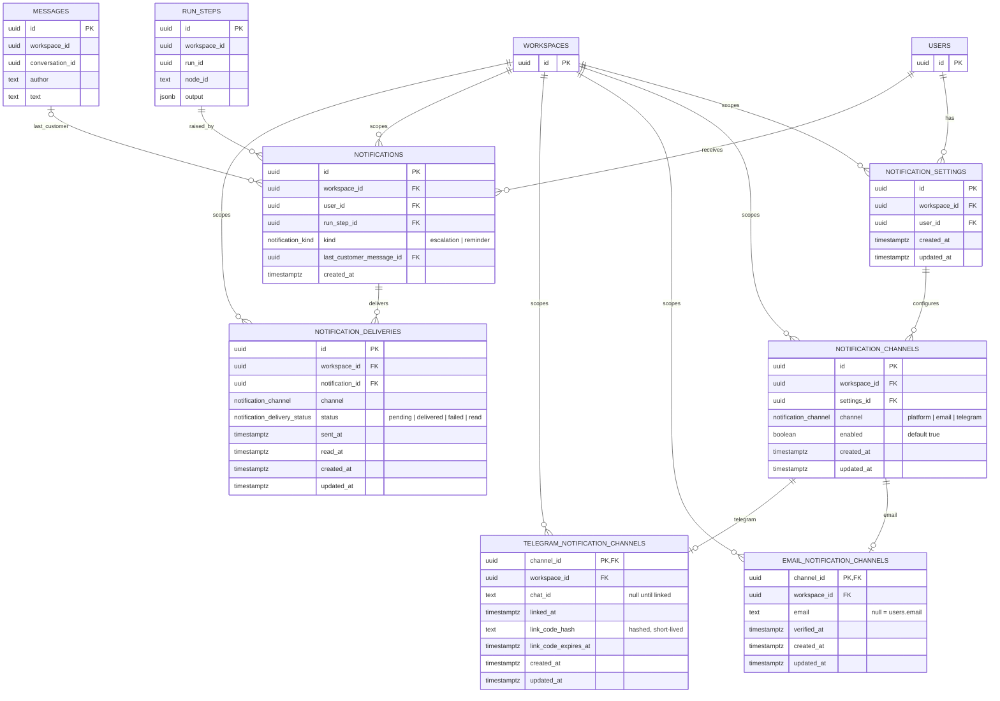

# Notifications module

**Status:** schema, settings API, recipient resolver, producer, read state, email delivery and browser notifications, November 2026. The `notifications` schema, the personal settings read/write API, the handoff recipient resolver, the escalation producer, the platform read state, the email delivery worker and in-app browser notifications exist. There is no background push/service worker, Telegram delivery, in-app notification list or reminder/fallback timer yet.

**Decisions:** D307 (notification storage), D85 (Resend), D167 (email gateway). Product requirements: `mvp-scope.md` §12.11, `communication.md` chain F.

**Scope:** per-person notification settings, per-channel configuration, the notification record for an escalation, and the per-channel delivery state. It does not implement the escalation producer, the alerts bot, browser notifications, reminders or the fallback message.

---

## 1. What is built

One Postgres schema, `notifications`, with six tables:

| Table | Purpose |
| --- | --- |
| `notification_settings` | one row per `(workspace, user)`; the root of a person's settings in that workspace |
| `notification_channels` | one row per enabled/disabled channel; `platform`, `email`, `telegram` |
| `email_notification_channels` | email-specific configuration, 1:1 with a channel |
| `telegram_notification_channels` | Telegram-specific configuration, 1:1 with a channel |
| `notifications` | one row per person per handoff step; the in-app notification |
| `notification_deliveries` | one row per notification and channel; delivery state |

`platform` is a `notification_channels` row with no detail table. Email and Telegram have a detail row because their configuration differs.

There is **no `escalations` table**. The escalation is the `runs.run_steps` row that handed off. The reason is already stored in that step's output, and the last customer message is referenced by id.

The trigger is the durable `runs.escalated` domain event. It fires for three handoffs: an Escalation node in `escalate` mode, an Agent or Completion exit set to hand off, and a step that fails with the flow's `onUnhandledFailure` set to hand off. The payload carries `runStepId`, the id of the `runs.run_steps` row that handed off, so the producer references the exact step even when the same node runs in parallel branches. Simulations emit the event too; the producer skips `mode = simulation`.

The personal settings slice is built:

- `notificationSettings` returns the effective settings for the signed-in user in the current workspace;
- `updateNotificationChannel` toggles `platform`, `email` or `telegram`;
- `updateNotificationEmail` stores an alert address.

Reads return defaults without writing a row: platform and email on, Telegram off until it is linked. The first update creates the settings row and one channel row per channel.

Recipient resolution is built. `NotificationRecipientsService.recipientsFor(workspaceId, versionId, nodeId)` turns a handoff step into `{ userId, channels }[]`:

- an Escalation node in `escalate` mode uses `node.config.notify`; an Agent or failure handoff uses `flow.settings.handoff.notify`;
- `operators` means the Operator role, `role` the chosen role, `users` the listed members;
- the requested flow channels are intersected with each user's enabled channels, and Telegram is dropped until it is linked;
- a user with no remaining channels is left out.

It does not create a notification yet; that is the producer's job.

The producer is a `runs` listener on `runs.escalated`, not a notifications listener. `notifications` cannot import `runs` or `conversations` without a cycle through `usage`; `runs` already imports both. For a live handoff the listener:

- calls `NotificationRecipientsService.recipientsFor`;
- reads the last customer message through `MessagesRepository.findLatestCustomerMessage`;
- writes one `notifications` row per recipient and one `notification_deliveries` row per channel, idempotently on the existing unique keys;
- marks platform deliveries `delivered` with `sent_at`, and leaves email and Telegram `pending` for the delivery worker;
- skips `mode = simulation`.

The delivery worker and sweeper are still missing.

The email delivery worker is built. The producer enqueues a `deliver-notification` job for each `email` delivery after the transaction commits. The worker loads the notification, delivery, user, run step and last message in one tenant transaction, renders the escalation email, sends it through `EmailGateway` outside the transaction, then marks the delivery `delivered` or `failed`. A provider failure rethrows so BullMQ retries; without retry metadata, the row stays `failed` and the job attempt count is BullMQ's only bound.

Telegram deliveries stay `pending` and are not enqueued yet.

The platform read state is built. `unreadNotificationCount` counts the signed-in user's platform deliveries whose status is not `read`, and `markNotificationsRead` sets them to `read` with `read_at` when the operator opens that conversation. The Inbox page calls it when the selected conversation changes. Email and Telegram deliveries are never counted and never marked read.

The existing Inbox navigation badge still uses the workspace-level `inboxNeedsYouCount`; it now refetches on focus, on visibility and every 30 seconds so a missed live event does not leave it stale.

Browser notifications are built. `latestUnreadNotification` returns the signed-in user’s newest unread platform notification with its conversation, customer name, channel and reason, but only while that conversation is still `waiting`. A conversation that is closed or taken over no longer produces a card, even if its delivery was never marked read. The workspace shell watches the notification and refetches on `inboxActivity`. When the tab is visible it shows an in-app card with the customer, the channel and the waiting time; when the tab is hidden and the browser permission is granted it shows a desktop notification instead. Clicking either opens `/inbox?conversation=...`. Permission is requested from Settings, Notifications. This works only while the app is open; there is no service worker or background push.

## 2. Schema



The `USERS`, `WORKSPACES`, `RUN_STEPS` and `MESSAGES` blocks are stubs: only the columns the notifications schema uses are shown. The real tables live in `identity`, `runs` and `conversations`.

## 3. Constraints and indexes

Every table has `workspace_id`, `ENABLE ROW LEVEL SECURITY`, `FORCE ROW LEVEL SECURITY` and the `tenant_isolation` policy on `workspace_id`. That is why child tables repeat `workspace_id` even though it is derivable through the parent.

### `notification_settings`

- unique `(workspace_id, id)` — the target of the channels' composite FK;
- unique `(workspace_id, user_id)` — one settings row per person per workspace;
- index `(user_id)`;
- FK `workspace_id -> identity.workspaces(id)` cascade;
- FK `user_id -> identity.users(id)` cascade.

### `notification_channels`

- unique `(workspace_id, id)` — the target of the detail tables' composite FK;
- unique `(settings_id, channel)` — one row per channel per settings;
- index `(workspace_id, settings_id)`;
- composite FK `(workspace_id, settings_id) -> notification_settings(workspace_id, id)` cascade;
- FK `workspace_id -> identity.workspaces(id)` cascade.

### `email_notification_channels` / `telegram_notification_channels`

- `channel_id` is the PK and the 1:1 link to `notification_channels`;
- composite FK `(workspace_id, channel_id) -> notification_channels(workspace_id, id)` cascade;
- FK `workspace_id -> identity.workspaces(id)` cascade;
- index `(workspace_id, channel_id)`;
- Telegram: partial unique index on `link_code_hash` where it is not null, and index `(workspace_id, chat_id)`.

### `notifications`

- unique `(workspace_id, id)` — the target of the deliveries' composite FK;
- unique `(run_step_id, user_id, kind)` — one notification per person per handoff step per kind, so a retry does not duplicate;
- index `(workspace_id, user_id, created_at desc)` for the in-app list;
- index `(workspace_id, run_step_id)`;
- index `(user_id)`;
- partial index `(workspace_id, last_customer_message_id)` where it is not null;
- FK `run_step_id -> runs.run_steps(id)` cascade;
- composite FK `(workspace_id, last_customer_message_id) -> conversations.messages(workspace_id, id)` cascade;
- FKs `workspace_id -> identity.workspaces(id)` and `user_id -> identity.users(id)` cascade.

### `notification_deliveries`

- unique `(notification_id, channel)` — idempotent delivery; a retry updates the row;
- index `(workspace_id, status, created_at)` for the pending/failed sweeper;
- index `(workspace_id, notification_id)`;
- composite FK `(workspace_id, notification_id) -> notifications(workspace_id, id)` cascade;
- FK `workspace_id -> identity.workspaces(id)` cascade;
- `status` defaults to `pending`.

## 4. How the notification content is derived

| Content | Source |
| --- | --- |
| reason | the handoff step's output: `reason` on an Escalation step, `outcome_reason` on an Agent exit, or the step error on a failure handoff, with the flow's handoff reason as fallback |
| run, conversation, agent, version | `run_steps.run_id` → `runs` → `conversations` |
| who receives | `notifications.user_id` → `identity.users` |
| greeting name and locale | `identity.users.name`, `identity.users.locale` |
| email address | `email_notification_channels.email`, or `identity.users.email` when null |
| Telegram chat | `telegram_notification_channels.chat_id` |
| last customer message | `notifications.last_customer_message_id` → `conversations.messages` |

`node_id`, `run_id` and `conversation_id` are **not** stored on `notifications`. They are read through `run_step_id`.

## 5. Delivery state

`notification_deliveries.status` is one of:

```text
pending -> delivered
        -> failed
        -> read
```

- `pending` is the row written before any provider call. This is the durable "should be sent" record.
- `delivered` means the provider accepted the message (email/Telegram) or the in-app row is visible (platform).
- `failed` means the provider call failed; the row stays for a retry.
- `read` is the in-app read state. It is stored on the delivery row in the current model, together with `read_at`.

The current schema has no retry metadata yet: no `attempts`, `next_attempt_at`, `locked_until` or `last_error`. A sweeper cannot bound retries without them. They should be added before the first delivery worker.

## 6. What is still missing

- A sweeper; the email worker is built. No retry metadata or scheduled recovery for `pending`/`failed` rows.
- Telegram delivery and the alerts bot linking flow (`chat_id`, hashed code, 10-minute expiry). Telegram deliveries stay `pending`.
- Background browser push and a service worker. Browser notifications work only while the app is open.
- The in-app notification list. The personal unread count and mark-read API exist, but the Inbox navigation badge still uses `inboxNeedsYouCount`.
- Reminder and fallback timers.
- `notification_settings.enabled`, working hours and time zone. Today the only switch is per channel.
- Provider-specific retry policy and rate limits.
- Master switch semantics: `notification_channels.enabled` is the only toggle; there is no separate "all notifications off".

## 7. Decisions to revisit

- Do we store `reason` as a snapshot on the notification, or keep reading `run_steps.output`? The current design reads it; a snapshot would survive run-step retention changes.
- Should the notification row be created after `steps.finish` (event moved) or should the listener retry until `output->>'reason'` exists? The current schema allows either.

## 8. Migration

`0046_notifications-tables.sql` creates the schema, three enums and the six tables, then adds the RLS policies and `FORCE ROW LEVEL SECURITY` for each table. It is additive: no existing table changes.
