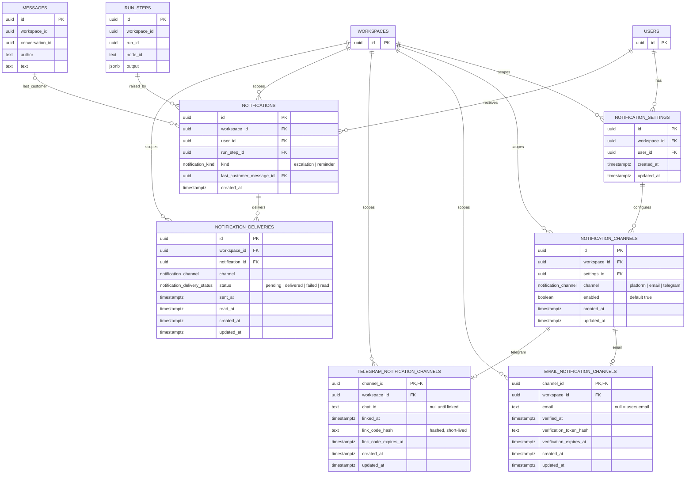

# Notifications module

**Status:** schema, settings API, recipient resolver, producer, read state, email delivery, browser notifications, Telegram alerts bot linking and Telegram alert delivery, reminders and fallback, the in-app notification list, and verified alert emails, November 2026. The `notifications` schema, the personal settings read/write API, the handoff recipient resolver, the escalation producer, the platform read state, the email delivery worker, in-app browser notifications, the Telegram alerts bot linking flow, Telegram alert delivery, the scheduled escalation reminders/fallback and the in-app notification list exist. There is no background push.

**Decisions:** D307 (notification storage), D85 (Resend), D167 (email gateway), D311 (Telegram alerts bot linking), D312 (Telegram alert delivery), D314 (reminders and fallback). Product requirements: `mvp-scope.md` §12.11, `communication.md` chain F.

**Scope:** per-person notification settings, per-channel configuration, the notification record for an escalation or reminder, the per-channel delivery state and the fallback message.

---

## 1. What is built

One Postgres schema, `notifications`, with six tables:

| Table | Purpose |
| --- | --- |
| `notification_settings` | one row per `(workspace, user)`; the root of a person's settings in that workspace |
| `notification_channels` | one row per enabled/disabled channel; `platform`, `email`, `telegram` |
| `email_notification_channels` | email-specific configuration, 1:1 with a channel |
| `telegram_notification_channels` | Telegram-specific configuration, 1:1 with a channel |
| `notifications` | one row per person per handoff step; the in-app notification |
| `notification_deliveries` | one row per notification and channel; delivery state |

`platform` is a `notification_channels` row with no detail table. Email and Telegram have a detail row because their configuration differs.

There is **no `escalations` table**. The escalation is the `runs.run_steps` row that handed off. The reason is already stored in that step's output, and the last customer message is referenced by id.

The trigger is the durable `runs.escalated` domain event. It fires for three handoffs: an Escalation node in `escalate` mode, an Agent or Completion exit set to hand off, and a step that fails with the flow's `onUnhandledFailure` set to hand off. The payload carries `runStepId`, the id of the `runs.run_steps` row that handed off, so the producer references the exact step even when the same node runs in parallel branches. Simulations emit the event too; the producer skips `mode = simulation`.

The personal settings slice is built:

- `notificationSettings` returns the effective settings for the signed-in user in the current workspace;
- `updateNotificationChannel` toggles `platform`, `email` or `telegram`;
- `updateNotificationEmail` stores an alert address and sends a verification email.
- `resendNotificationEmailVerification` sends a fresh verification email while the address is pending.
- `verifyNotificationEmail` consumes the current token and marks the address verified.

Reads return defaults without writing a row: platform and email on, Telegram off until it is linked. The first update creates the settings row and one channel row per channel.

The alert email is verified before it receives alerts. A custom address stores a SHA-256 verification token hash and a 24-hour expiry on `email_notification_channels`; changing the address clears both `verified_at` and the open token. The verification email links back to Settings → Notifications with the token in the query string, and `verifyNotificationEmail` sets `verified_at` once. `resendNotificationEmailVerification` replaces the token while the address is pending. Until a custom address is verified, escalation emails fall back to the user's account email, which the auth confirmation flow already verified. A `null` alert address therefore means "use the account email" and needs no separate verification.

Recipient resolution is built. `NotificationRecipientsService.recipientsFor(workspaceId, versionId, nodeId)` turns a handoff step into `{ userId, channels }[]`:

- an Escalation node in `escalate` mode uses `node.config.notify`; an Agent or failure handoff uses `flow.settings.handoff.notify`;
- `operators` means the Operator role, `role` the chosen role, `users` the listed members;
- the requested flow channels are intersected with each user's enabled channels, and Telegram is dropped until it is linked;
- a user with no remaining channels is left out.

It does not create a notification yet; that is the producer's job.

The producer is a `runs` listener on `runs.escalated`, not a notifications listener. `notifications` cannot import `runs` or `conversations` without a cycle through `usage`; `runs` already imports both. For a live handoff the listener:

- calls `NotificationRecipientsService.recipientsFor`;
- reads the last customer message through `MessagesRepository.findLatestCustomerMessage`;
- writes one `notifications` row per recipient and one `notification_deliveries` row per channel, idempotently on the existing unique keys;
- marks platform deliveries `delivered` with `sent_at`, and leaves email and Telegram `pending` for the delivery worker;
- skips `mode = simulation`.

The delivery workers and the retry sweeper are built (D313).

The email delivery worker is built. The producer enqueues a `deliver-notification` job for each `email` delivery after the transaction commits. The worker loads the notification, delivery, user, run step and last message in one tenant transaction, renders the escalation email, sends it through `EmailGateway` outside the transaction, then marks the delivery `delivered` or `failed`. A provider failure stores the retry schedule and rethrows; D313 owns the backoff and the sweeper.

The Telegram alerts bot link flow is built. Settings calls `createTelegramNotificationLink`, which stores only a hash of a six-digit 10-minute code. A code that collides with another active hash is replaced with a fresh one, up to five attempts, and each attempt runs in its own tenant transaction so an aborted insert does not poison the next. The global alerts bot receives `/start <code>` or a pasted code over its webhook or local poller, hashes it, finds the Telegram notification channel across workspaces through the allow-listed `TelegramLinkRepository`, checks expiry, stores `chat_id`, `username` and `linked_at`, clears the code, enables the Telegram channel and replies to the chat. An expired code is cleared when the bot sees it, and a `timers` job every 60 seconds clears any remaining expired hashes through the same system-level repository. `telegram_notification_channels` has a `username` column for the linked Telegram account.

Telegram delivery is built. The producer enqueues a `deliver-notification` job for each `telegram` delivery after commit alongside email. The worker loads the notification, delivery, user, run step, last customer message and the linked `chat_id` in one tenant transaction; it sends only while the Telegram channel is enabled and linked. `NotificationSettingsService.telegramChatId` returns the chat id or null. The alert is localized HTML shaped like the Telegram design: a bold `Chat needs a person` title, a bold customer · channel · agent line, the last customer message (truncated to 500 characters) in italics, and a bold `Reason:` label. The blocks are separated by blank lines. It is sent through `TelegramGateway.sendMessage` with `TELEGRAM_ALERTS_BOT_TOKEN` and `parse_mode: HTML`. The message carries two inline buttons: Open in Inbox, a URL to the same Inbox link the email uses, and Take over, a callback carrying the workspace and conversation public ids. A callback is accepted only from a chat linked to that workspace; it emits `notifications.telegram-alert-take-over-requested`, and the conversations listener builds the linked user's context and takes over only when the chat is still available. It answers with the outcome: taken over, already handled by the same user, already handled by another operator (named), or the chat is closed. After every attempt the keyboard becomes a single Open in Inbox button for that conversation, so the operator can still open it after a failed takeover. A missing chat id or bot token marks the delivery `failed`; a provider failure marks it `failed` and rethrows so BullMQ retries.

Reminders and fallback are built from delayed BullMQ jobs, with no timer table. The `runs.escalated` producer schedules a `runs.fire-escalation-timer` job on `timers` for the reminder and another for the fallback, using the `reminderAfterMinutes` and `fallbackAfterMinutes` carried by the event. The jobs use deterministic ids (`escalation-reminder-<runStepId>` and `escalation-fallback-<runStepId>`), so a retried event producer does not add a second timer. `JobsService.enqueue` passes the delay to BullMQ; the durable outbox path also stores the delay in the envelope so a swept-out message keeps its remaining delay.

When a timer fires, the job loads the handoff `runStepId`, its run, conversation, version and flow, and does nothing unless the conversation is still `waiting` and live. A reminder creates `kind = reminder` notifications for the same recipients and channels as the escalation; an existing reminder row for that run step stops a second one. The fallback is rendered from the run history plus the handoff step's input and sent through the normal outbound path with an idempotency key derived from the `runStepId`. The fallback wins when both are overdue, so a worker that was down does not send a stale reminder before the fallback. Takeover, hand-back and close need no explicit cancel: the job finds the conversation no longer `waiting` and does nothing.

The platform read state is built. `unreadNotificationCount` counts the signed-in user's platform deliveries whose status is not `read`, and `markNotificationsRead` sets them to `read` with `read_at` when the operator opens that conversation. The Inbox page calls it when the selected conversation changes. Email and Telegram deliveries are never counted and never marked read.

The existing Inbox navigation badge still uses the workspace-level `inboxNeedsYouCount`; it now refetches on focus, on visibility and every 30 seconds so a missed live event does not leave it stale.

Browser notifications are built. `latestUnreadNotification` returns the signed-in user’s newest unread platform notification with its conversation, customer name, channel and reason, but only while that conversation is still `waiting`. A conversation that is closed or taken over no longer produces a card, even if its delivery was never marked read. The workspace shell watches the notification and refetches on `inboxActivity`. When the tab is visible it shows an in-app card with the customer, the channel and the waiting time; when the tab is hidden and the browser permission is granted it shows a desktop notification instead. Clicking either opens `/inbox?conversation=...`. Permission is requested from Settings, Notifications. This works only while the app is open; there is no service worker or background push.

System emails cover confirmation, password reset, email change, the 80/100% usage thresholds and a revoked Telegram token. The last one is produced by the durable `channels.telegram-token-revoked` event when `ChannelHealthService.markBroken` moves a connected channel to `broken`. A `channels` listener sends the localized email to every owner and admin of the workspace with a link to the Telegram channel page.

## 2. Schema



The `USERS`, `WORKSPACES`, `RUN_STEPS` and `MESSAGES` blocks are stubs: only the columns the notifications schema uses are shown. The real tables live in `identity`, `runs` and `conversations`.

## 3. Constraints and indexes

Every table has `workspace_id`, `ENABLE ROW LEVEL SECURITY`, `FORCE ROW LEVEL SECURITY` and the `tenant_isolation` policy on `workspace_id`. That is why child tables repeat `workspace_id` even though it is derivable through the parent.

### `notification_settings`

- unique `(workspace_id, id)` — the target of the channels' composite FK;
- unique `(workspace_id, user_id)` — one settings row per person per workspace;
- index `(user_id)`;
- FK `workspace_id -> identity.workspaces(id)` cascade;
- FK `user_id -> identity.users(id)` cascade.

### `notification_channels`

- unique `(workspace_id, id)` — the target of the detail tables' composite FK;
- unique `(settings_id, channel)` — one row per channel per settings;
- index `(workspace_id, settings_id)`;
- composite FK `(workspace_id, settings_id) -> notification_settings(workspace_id, id)` cascade;
- FK `workspace_id -> identity.workspaces(id)` cascade.

### `email_notification_channels` / `telegram_notification_channels`

- `channel_id` is the PK and the 1:1 link to `notification_channels`;
- composite FK `(workspace_id, channel_id) -> notification_channels(workspace_id, id)` cascade;
- FK `workspace_id -> identity.workspaces(id)` cascade;
- index `(workspace_id, channel_id)`;
- Email: partial unique index on `verification_token_hash` where it is not null;
- Telegram: partial unique index on `link_code_hash` where it is not null, and index `(workspace_id, chat_id)`.

### `notifications`

- unique `(workspace_id, id)` — the target of the deliveries' composite FK;
- unique `(run_step_id, user_id, kind)` — one notification per person per handoff step per kind, so a retry does not duplicate;
- index `(workspace_id, user_id, created_at desc)` for the in-app list;
- index `(workspace_id, run_step_id)`;
- index `(user_id)`;
- partial index `(workspace_id, last_customer_message_id)` where it is not null;
- FK `run_step_id -> runs.run_steps(id)` cascade;
- composite FK `(workspace_id, last_customer_message_id) -> conversations.messages(workspace_id, id)` cascade;
- FKs `workspace_id -> identity.workspaces(id)` and `user_id -> identity.users(id)` cascade.

### `notification_deliveries`

- unique `(notification_id, channel)` — idempotent delivery; a retry updates the row;
- index `(workspace_id, status, created_at)`;
- index `(status, next_attempt_at)` for the retry sweeper;
- index `(workspace_id, notification_id)`;
- composite FK `(workspace_id, notification_id) -> notifications(workspace_id, id)` cascade;
- FK `workspace_id -> identity.workspaces(id)` cascade;
- `status` defaults to `pending`;
- `attempts` defaults to `0`;
- `next_attempt_at`, `locked_until` and `last_error` start null.

## 4. How the notification content is derived

| Content | Source |
| --- | --- |
| reason | the handoff step's output: `reason` on an Escalation step, `outcome_reason` on an Agent exit, or the step error on a failure handoff, with the flow's handoff reason as fallback |
| run, conversation, agent, version | `run_steps.run_id` → `runs` → `conversations` |
| who receives | `notifications.user_id` → `identity.users` |
| greeting name and locale | `identity.users.name`, `identity.users.locale` |
| email address | a verified `email_notification_channels.email`, or `identity.users.email` when null or still pending verification |
| Telegram chat | `telegram_notification_channels.chat_id` |
| last customer message | `notifications.last_customer_message_id` → `conversations.messages` |

`node_id`, `run_id` and `conversation_id` are **not** stored on `notifications`. They are read through `run_step_id`.

## 5. Delivery state

`notification_deliveries.status` is one of:

```text
pending -> delivered
        -> failed
        -> read
```

- `pending` is the row written before any provider call. This is the durable "should be sent" record.
- `delivered` means the provider accepted the message (email/Telegram) or the in-app row is visible (platform).
- `failed` means the provider call failed; `next_attempt_at` says whether and when the row may be retried.
- `read` is the in-app read state. It is stored on the delivery row in the current model, together with `read_at`.

### Delivery retries

Before a provider call, the worker claims the row in a tenant transaction: `attempts` increases, `locked_until` becomes now + 60 seconds and the row is returned only when it is `pending`/`failed`, has attempts left, its `next_attempt_at` is due and its lock is free. A second job or a sweeper tick therefore does not send the same delivery twice.

On a provider failure the row becomes `failed` with `last_error` (at most 1,000 characters) and a `next_attempt_at`. The delay is exponential from 30 seconds up to 1 hour; a Telegram `429` uses its `retry_after` instead. After five attempts `next_attempt_at` is null and the row is not retried again. A disabled channel or missing destination is failed with no retry.

A `timers` job every 60 seconds reads up to 100 due rows across workspaces through the allow-listed `NotificationDeliverySweepRepository` and enqueues one `deliver-notification` job per row. The sweeper does not send; the worker claim is still the only place that does.

## 6. What is still missing

- Dead-letter handling and alerting after a delivery runs out of attempts. The retry metadata and the sweeper are built.
- Background browser push and a service worker. Browser notifications work only while the app is open.
- The in-app notification list. The personal unread count and mark-read API exist, but the Inbox navigation badge still uses `inboxNeedsYouCount`.
- Removing the delayed jobs on takeover/hand-back/close. They currently fire and no-op because the conversation is no longer `waiting`; removing them would only keep the `timers` queue cleaner.
- `notification_settings.enabled`, working hours and time zone. Today the only switch is per channel.
- Provider-specific retry policy and rate limits.
- Master switch semantics: `notification_channels.enabled` is the only toggle; there is no separate "all notifications off".

## 7. Decisions to revisit

- Do we store `reason` as a snapshot on the notification, or keep reading `run_steps.output`? The current design reads it; a snapshot would survive run-step retention changes.
- Should the notification row be created after `steps.finish` (event moved) or should the listener retry until `output->>'reason'` exists? The current schema allows either.

## 8. Migration

`0046_notifications-tables.sql` creates the schema, three enums and the six tables, then adds the RLS policies and `FORCE ROW LEVEL SECURITY` for each table. It is additive: no existing table changes.
